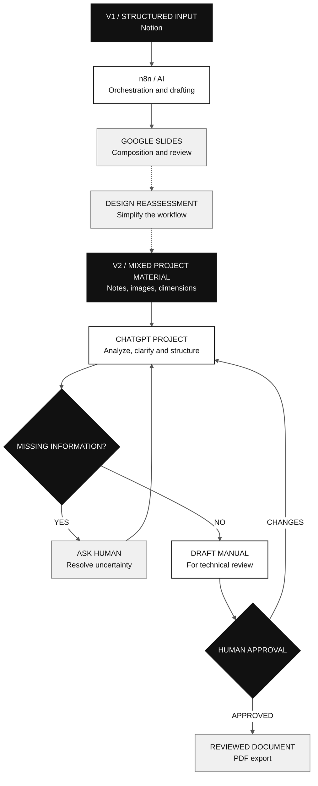

# Manual Generator


**Redesigning a complicated documentation workflow into a human-reviewed AI process.**

I designed and implemented Manual Generator to turn scattered installation material into a structured, reviewable technical manual. The first version automated an existing process through Notion, n8n, Google Drive, AI and Google Slides. The second version simplified the workflow around a conversational ChatGPT Project: analyze what exists, identify missing information, ask targeted questions, prepare a draft and keep a human responsible for approval.

**This is a public technical companion, not a production workflow export.** The examples are reconstructed illustrations based on project decisions and entirely synthetic data. No confidential studio materials, original workflow exports or private instructions are included.

[View the portfolio case study](https://barbarakprokop.com/productdesign/case-study-manual-generator/) · [Product design portfolio](https://barbarakprokop.com/productdesign/) · [GitHub profile](https://github.com/barbarakprokop)

## The design problem

A manual can start with photographs, rough notes, dimensions, installation details and missing decisions spread across several places. Automating the document before clarifying the source material can simply automate mistakes.

The key design choice: **an unanswered technical question is a visible workflow state, not permission for AI to guess.**

## Architecture: two iterations



**Dashed transition:** V1 and V2 are successive design approaches, not one continuous production automation. The V2 path is a conceptual summary, not an executable ChatGPT Project graph.

## What changed

| V1 | V2 |
| --- | --- |
| Structured fields before processing | Accept messy source material, then clarify |
| n8n orchestrates multiple systems | A ChatGPT Project provides the conversational workflow |
| Google Slides assembly | Reviewable document and PDF export |
| Automation complexity increases with integrations | Fewer tools, clearer human decisions |

The case study reports preparation going from roughly **2–3 days to 1–2 hours**. That is experience from the project, not a benchmark established by these public tests.

## Inspect the decisions

The repository includes small, dependency-free examples:

- [`src/review-gate.mjs`](src/review-gate.mjs): missing fields and contradictions stop automatic drafting; even a good draft needs review.
- [`src/document-plan.mjs`](src/document-plan.mjs): structure a sample manual without fabricating facts or images.
- [`src/retry-guard.mjs`](src/retry-guard.mjs): prevent duplicate status-triggered processing.
- [`examples/`](examples/): fictional complete and incomplete source records.
- [`tests/logic.test.mjs`](tests/logic.test.mjs): seven runnable tests.

With Node.js 20 or newer:

```bash
npm test
```

These examples **do not** call AI, use n8n, create PDFs, access live services or implement production approval controls. They demonstrate the information architecture behind the workflow.

Read [architecture and design decisions](docs/architecture-and-decisions.md) and [security boundaries](SECURITY.md).

**Designed and built by Barbara K. Prokop**  
**PRODUCT DESIGNER & BUILDER · AI PRODUCTS & WORKFLOWS**
